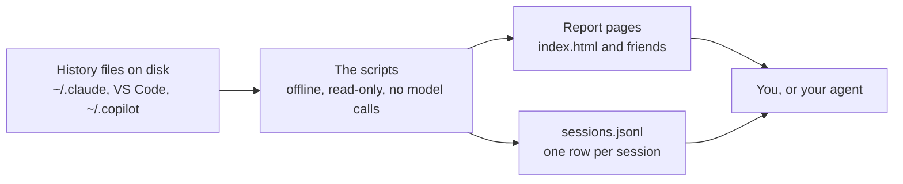
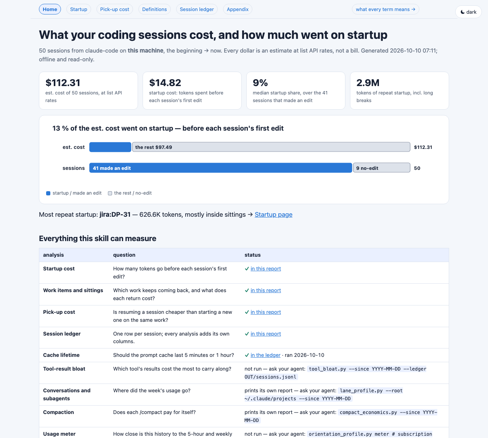
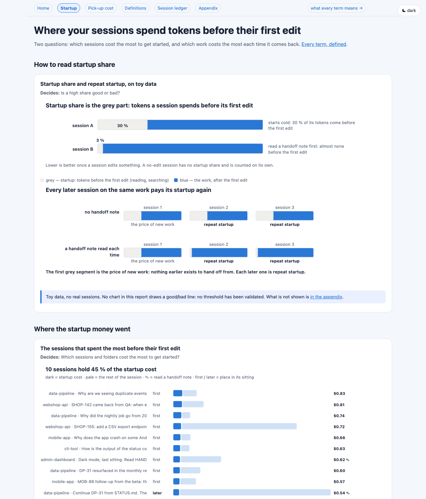
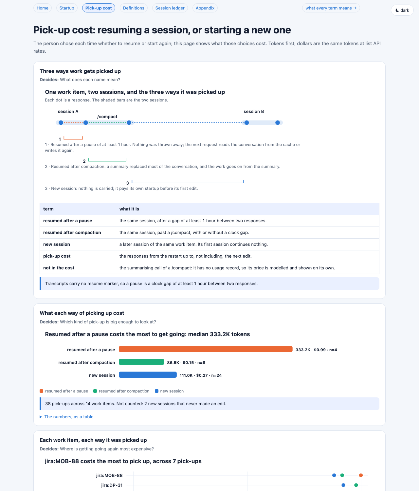
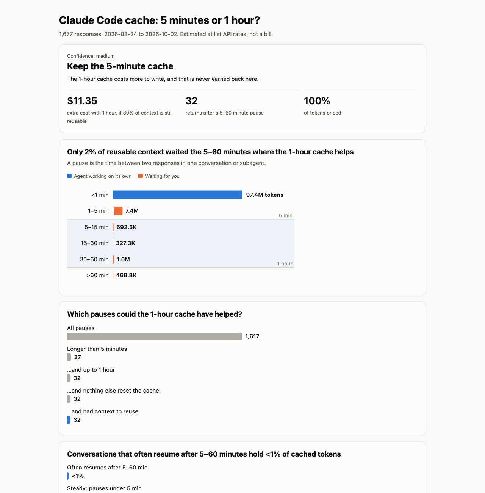

# agent-session-audit

An agent skill, plus the Python scripts behind it, that audits your local
coding-agent history: where the tokens went, and what to change. It reads the
transcripts Claude Code already keeps on disk (GitHub Copilot's too,
best-effort). It counts them correctly, then writes a self-contained visual
report and a sortable per-session table. Dollar figures are estimated cost at list API
rates: an estimate for comparing sessions, not a bill. Ask your agent "where
did my tokens go last week?", or run the scripts yourself.

## What it answers

- **Where did my usage go?** Which conversations and subagents cost the most,
  and why. Usually it is long conversations re-reading a large context, not
  cache misses.
- **How much does each session spend getting started?** Tokens spent before the
  first edit, and which pieces of work keep paying that again.
- **Does writing a handoff note pay for itself?** A field log you keep, read
  back with exact statistics. It says "not enough data yet" until there is.
- **Carry on or start fresh?** What resuming a session cost, compared with a new
  session on the same work.
- **What did compaction cost**, and was the cache still warm?
- **Which tool results bloat the context** and get paid for on every later turn?
- **Which reasoning-effort level did a session actually run at?**
- **5-minute or 1-hour prompt cache?** A what-if comparison: would the 1-hour
  cache have paid off, given how long your pauses between responses are?

## How it works



## What the report looks like


*Home — where did my tokens go, in one picture?*


*Startup — how much do sessions spend before their first edit, and where?*


*Picking work back up — was resuming cheaper than starting a new session?*


*Cache — would a 1-hour cache lifetime have cost less than 5 minutes?*

The screenshots come from a synthetic demo history, not real usage.

## Terms

| term | meaning |
|---|---|
| startup share | share of a session's tokens spent before its first edit |
| first edit | the first successful change to a file: an edit, a write, or a file-changing command |
| no-edit session | never changed a file (questions, reviews, research); it has no startup share |
| sitting | sessions on the same work with no gap longer than 72 hours |
| work item | the same work across any gap, linked by ticket, branch or shared files |
| repeat startup | startup spent by every session after the first in a sitting |
| pick-up cost | what it cost to get going again, up to the next edit |
| read a handoff note | opened a HANDOFF/STATUS-style note in its first two turns |
| est. cost | estimated cost at list API rates; for comparing, not billing |
| cache lifetime | how long a prompt-cache entry lives: 5 minutes or 1 hour |

## Privacy

- **Offline and read-only.** The scripts read local history files and write
  reports. They never call a model, never launch an agent, and need no network.
- **Reports are complete and stay local.** By default they include real paths,
  session titles, first prompt lines and one-line tool arguments; that is what
  makes them useful to you. Files are created readable by your user only (where
  the filesystem supports it). Write them under your working directory, not a
  shared temp directory.
- **Your home folder is shown as `~`.** Every analysis writes and prints paths
  under it as `~/...`, in every file and every line of output.
- **Before sharing anything**, re-run with `--redact` and check the result with
  `--privacy-check` (below). Even then, share totals, not raw sessions.

## Requirements

Python 3.9 or newer. Standard library only — nothing to install.

## Install

**Claude Code**

```bash
git clone https://github.com/edd426/agent-session-audit ~/.claude/skills/agent-session-audit
```

On Windows (PowerShell):

```powershell
git clone https://github.com/edd426/agent-session-audit "$env:USERPROFILE\.claude\skills\agent-session-audit"
```

Then ask Claude Code something like "where did my tokens go last week?" or
"should I use the 1-hour cache?". The skill's `SKILL.md` sends the question to
the right script.

**Other agents that load `SKILL.md` skills:** place the folder in that agent's
skills directory.

## Try it without your own data

```bash
python3 scripts/demo_history.py --out ./demo-root
python3 scripts/orientation_profile.py report --root ./demo-root --store claude-code \
  --output-dir ./demo-report --ledger ./demo-report/sessions.jsonl
```

`--store claude-code` keeps the demo to the demo history; without it, the
report also reads your own Copilot history from its default locations. Then
open `./demo-report/index.html`.

## Running it without an agent

macOS / Linux:

```bash
SKILL=~/.claude/skills/agent-session-audit        # wherever you cloned it
OUT="./agent-audit-$(date +%F)"
python3 "$SKILL/scripts/orientation_profile.py" report \
  --root ~/.claude --output-dir "$OUT" --ledger "$OUT/sessions.jsonl"
open "$OUT/index.html"                             # xdg-open on Linux
```

Windows (PowerShell):

```powershell
$SKILL = "$env:USERPROFILE\.claude\skills\agent-session-audit"
$OUT = ".\agent-audit-$(Get-Date -Format yyyy-MM-dd)"
python "$SKILL\scripts\orientation_profile.py" report `
  --root "$env:USERPROFILE\.claude" --output-dir $OUT --ledger "$OUT\sessions.jsonl"
Start-Process "$OUT\index.html"
```

The report is a set of linked HTML pages with no CDN or web fonts. A
`screen-pack/` folder holds one-screen pages for a projector or a meeting. The home page
lists every analysis and marks the ones not yet run. The others:

| question | script (in `scripts/`) |
|---|---|
| where did my usage go, by conversation and subagent | `lane_profile.py` |
| 1-hour or 5-minute cache | `claude_cache_audit.py --output-dir DIR` |
| what did compaction cost | `compact_economics.py` |
| which tool results bloat context | `tool_bloat.py` |
| does a handoff note pay for itself | `orientation_profile.py sessions --handoff-log FILE.csv` |

Every script takes `--help`, `--since` / `--until`, `--pricing-file`, and
`--include-cwd-pattern` / `--exclude-cwd-pattern` to filter by working
directory. Pass the same `--ledger PATH` to `orientation_profile.py`,
`claude_cache_audit.py` and `tool_bloat.py`; each adds its columns to the one
per-session table.

**Sharing a report:**

```bash
python3 "$SKILL/scripts/orientation_profile.py" report --redact --output-dir ./audit-redacted
python3 "$SKILL/scripts/test_orientation_profile.py" --privacy-check ./audit-redacted
```

`--redact` hashes working directories, cuts paths to file names, drops prompt
text and tool arguments, and leaves out the history folders it read. `--privacy-check` fails if a URL, email, GUID
or secret-shaped string survives.

## Supported history stores

| store | where | support |
|---|---|---|
| Claude Code | `~/.claude/projects/**/*.jsonl` (or `$CLAUDE_CONFIG_DIR`) | full: tokens, models, effort, tool calls, compaction |
| VS Code Copilot Chat | VS Code `workspaceStorage` / `globalStorage` | best-effort, startup and sitting views; token counts usually absent, so est. cost shows "—" (not recorded) |
| Copilot CLI | `~/.copilot` (session files and its SQLite store, opened read-only) | best-effort, startup and sitting views; est. cost "—" (not recorded) when there are no token counts |

Fields a store does not record are shown as unknown, never guessed. For an
unfamiliar or changed layout, `orientation_profile.py probe-store PATH` prints
key names and counts only, never values, so its output is safe to attach to an
issue.

A Copilot session without token counts gets no est. cost: it shows "—" (not
recorded), is left out of totals and medians, and counts as unpriced in the
price coverage. Prices come from `references/pricing-public-example.json`
(dated Anthropic list rates). Override it with `--pricing-file` if your rates differ. Every dollar
figure is printed with its price coverage.

## Running the tests

The suites build synthetic histories in a temporary folder; they never read
your own history.

```bash
cd scripts
python3 test_audit_common.py
python3 test_claude_cache_audit.py
python3 test_orientation_profile.py
python3 test_demo_history.py
python3 lane_profile.py --selftest
python3 compact_economics.py --selftest
python3 tool_bloat.py --selftest
python3 orientation_profile.py selftest
python3 session_ledger.py selftest
```

CI runs the same commands on Linux, macOS and Windows with Python 3.9 and 3.13.

## Layout

- `SKILL.md` — the entry point an agent loads: router, rules, quickstart.
- `scripts/` — the analyzers and their tests.
- `references/` — definitions, interpretation rules, the evidence behind them,
  the report spec, and the price table.
- `evals/` — trigger, non-trigger and end-to-end cases for the skill.
- `tests/fixtures/` — synthetic handoff-log inputs and expected output.

## License

MIT — see [LICENSE](LICENSE).
