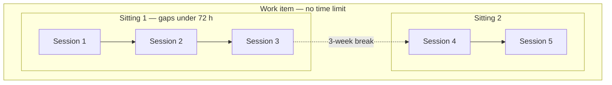
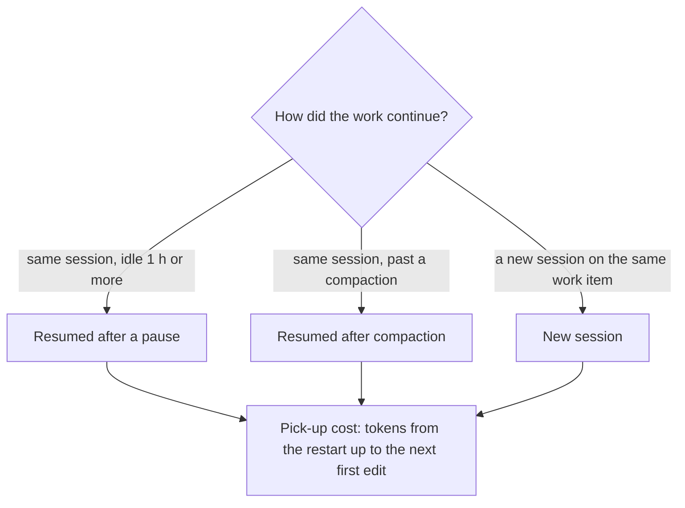

# Startup, sittings and work items

What `scripts/orientation_profile.py` measures and how to read each number.
Also: how to check its grouping on your own history, and how to run it on
Windows. Companion to `lane-economics.md` (where did usage go) and
`cache-economics.md` (which cache lifetime). Same history, same price table,
different question:

> How many tokens does a session spend before its first edit, and which pieces
> of work pay that cost again and again?

**Names.** The report uses plain words. The script, its JSON keys and its ledger
columns keep older names:

| shown in the report as | machine name |
|---|---|
| startup, startup share, startup cost | `orientation_tokens`, `orientation_share`, `orientation_cost_usd` |
| first edit | `first_mutation_*`, `boundary_turn_tokens` |
| no-edit session | `no_mutation` |
| sitting | `thread` (`thread_id`, the `threads` subcommand) |
| work item | `stream` (`stream_id`, `--stream-by`) |
| repeat startup / repeat startup, incl. long breaks | `reorientation_tax_tokens` per thread / per stream |
| resumed after a pause / after compaction / new session / ran in parallel / first session | `continuation_kind` = `R0` / `R1` / `R2` / `parallel` / `first` |
| pick-up cost | `carry_tokens`, `carry_cost_usd` |
| files read first | `orientation_breadth` |
| read a handoff note | `handoff_opened_by_turn_2` |
| started with a question | `question_first` |

## Contents

1 Startup share · 2 Sittings · 2b Handoff-note field log · 2c Work items ·
2d Session ledger · 2e Picking work back up · 3 Evidence · 4 Privacy ·
5 Running it on Windows · 5b Screen pack and meter ·
6 Interpretation rules · 7 The first-edit detector

---

## 1. Startup share

**Startup share** is the share of a session's tokens spent before its first
edit. Everything before the first edit is startup; everything from it on is
work. Tokens means all of them: input, output, cache reads and cache writes.
Re-reading a carried context through the cache is still startup.

Startup is a way to compare sessions, not a waste figure. People do it too:
Parnin & Rugaber (2011) found only 7 % of programming sessions start editing
without any navigation first. RepoMirage (arXiv 2605.26177) scores agents on
the same "share of steps before the first edit". A 30 % startup share means 30 %
spent getting oriented. The useful question is whether a similar session got
there for less.

### What counts as an edit

| call | counts as an edit when |
|---|---|
| `Edit`, `Write`, `MultiEdit`, `NotebookEdit` | always (the first three are Anthropic's own accepted-edit list, <https://code.claude.com/docs/en/analytics>) |
| `Bash` | a file-changing verb runs at command position (`sed -i`, `tee`, `mv`, `cp`, `rm`, `mkdir`, `git commit`, `kubectl apply`, a package install, …), or output is redirected to a real file |
| anything else | never |

The call must also succeed: a refused or failed write does not count (§7).
The report records which rule fired (`first_mutation_reason`), so a surprising
first edit can be checked.

Known misses:

| what happens | effect |
|---|---|
| a redirect to a scratch file (`grep foo > out.tmp`) | first edit found too early |
| a verb behind an unknown wrapper (`make deploy`, a project script) | first edit missed |
| an edit through an MCP tool or a custom tool | first edit missed; the session becomes a no-edit session |
| work whose result is an answer, not a file | correctly has no first edit |

### No-edit sessions

A **no-edit session** never changed a file: questions, reviews, research. It has
no startup share (`null`, not 100 %). It is reported as its own group. Such
sessions are often most sessions by count but a small share of tokens, which
is why counts are never the headline.

### One API response is one turn

Claude Code writes one JSONL row per content block and repeats the same `usage`
on each. Rows are merged on `(sessionId, message.id)`. Counting rows inflates
tokens about 2×, unevenly. Dropping repeats without merging loses their tool
calls ([evidence.md](evidence.md) E1).

### A README is not a handoff note

Reading a project README early is startup work. Reading a handoff note is the
cheap substitute for it. In practice, sessions that opened a handoff note
first had the lowest startup share, and sessions that opened a README had the
highest, above those that opened nothing. Pooling the two made notes look like
a cost ([evidence.md](evidence.md) E2). So `readme_opened_by_turn_2` is a
separate column, never part of "read a handoff note". A file the previous session in the sitting wrote last also
counts as a handoff note, whatever its name. General rule: never pool a lever
with something else that could explain it just because both are "notes".

### Files read first

Startup share alone cannot tell forty files read once from one file read forty
times. **Files read first** (`orientation_breadth`) counts distinct files
touched before the first edit; `orientation_tokens_per_path` sits beside it.

| startup tokens | files read first | reading | what might help |
|---|---|---|---|
| high | few | re-reading the same thing | possibly a handoff note (§6) |
| high | many | real discovery across the tree | a better index or map |
| low | few | already oriented, or a tiny task | nothing |

Searches (`Glob`, `Grep`, `LS`) do not count: their pattern or path is a query, not a file read.

### Other per-session fields

| field | meaning |
|---|---|
| `outcome` | `success` (ended on a commit or clean final check), `failure` (a failed tool result) or `unknown`. Inferred, since ordinary history has no answer key. `unknown` is never folded into success. Failed runs are 12–82 % longer (arXiv 2511.00197), so charts split by outcome. |
| `question_first` | started with a question: the first human turn is a question and the first edit follows a later human turn. Its startup was answering, not re-learning. `null` when the store has no user text. |
| `strategy` | from the tool counts: `read-only`; `scripted` (≤ 50 edits and file-changing shell calls ≥ edits); `by-hand` (> 50 edits, or edits without scripting); `mixed`. Scripted and by-hand edits cost very differently, so classify before comparing models. |
| `effort`, `effort_mix` | the reasoning-effort level recorded on each assistant record (`low` … `max`), read from `effort` (newer CLI) or `perTurnEffort` (some older versions), and per-turn counts. `null` when neither field is present. |
| `thinking_share` | reasoning tokens ÷ output tokens. `null`, never 0, when no thinking is recorded (headless runs record none). |
| `est_cost_usd` | estimated cost at list API rates, each turn at its own model's rate. For comparing sessions; never an invoice. `proxy_cost_usd` is a deprecated alias. |
| `stage_path` | stages startup → explore → edit → check (stored as `orient`, `explore`, `mutate`, `verify`), after Helicone's session paths and Coherence Collapse (arXiv 2603.24631). A session that goes back to startup after starting work shows its repeat startup as a shape. |
| `otel` | the same totals under OpenTelemetry GenAI attribute names (`gen_ai.usage.input_tokens`, …), read 2026-09-06. Those conventions are still provisional; the native names stay authoritative. |

### Effort, and thinking share as a cross-check

The effort level is read from `effort` (newer CLI) or `perTurnEffort` (some
older versions). The oldest versions record neither, so quote
`effort_recorded_share`, the fraction of turns that carry one of them.

Thinking share checks whether an effort setting took. Per-model medians
separate the bottom of the dial from the top, but do not order the top levels.
Use it to catch a run that silently used the default, not to rank `high`
against `xhigh`. Use per-model medians; one session is noise.

---

## 2. Sittings

Long work usually shows up as many short sessions, not one long one. A
**sitting** groups them. Two sessions join a sitting when all three hold:

1. same working directory;
2. the later one starts within `--gap-hours` (default 72) of the sitting's latest session;
3. they touched at least `--min-shared` (default 2) of the same file names.

A sitting stops growing at `--max-sessions` (default 12). A session can still
join if it shares `2 × --min-shared` files; every such exception is printed and
kept in `cap_justifications`. `--explain-caps` also shows the refused ones.



**Repeat startup** is the startup of every session after the first in a
sitting: sessions 2, 3 and 5 above. It is what a handoff note competes with.

### Check the grouping before quoting it

Grouping by metadata over-merges: one "sitting" can turn out to be one piece
of work plus unrelated tickets in a busy folder. Session-detection research
agrees: gap-only rules over-merge, gap plus content does better, and few tools
measure their rule (Gayo-Avello, 2009). Check yours before quoting any sitting number:

```bash
# 1. print sittings to label by hand
python3 scripts/orientation_profile.py threads --root ~/.claude --label-candidates 20 > candidates.txt

# 2. one line per sitting:  thread_id <TAB> yes|no|<k>
#    yes = one piece of work · no = two or more · k = exactly k pieces
#    thread_id <TAB> same_as:<other_thread_id> marks a join the rule missed

# 3. score the rule and sweep its settings
python3 scripts/orientation_profile.py threads --root ~/.claude --labels labels.tsv
```

It prints pair precision: of the session pairs grouped together, the share
the labels agree with. It also sweeps `--gap-hours` ∈ {24, 48, 72, 120, 168} ×
`--min-shared` ∈ {1, 2, 3, 4}. Two caveats print with it. Precision assumes a
sitting's k pieces split its sessions evenly. Recall is `null` unless you
supply `same_as:` lines. Until you have labelled your history, call every
sitting number uncalibrated.

## 2b. The handoff-note field log (`--handoff-log`)

Does writing a short handoff note at the end of a session pay off in the next
one? On real work, the only way to know is to log it.

```bash
python3 scripts/orientation_profile.py sessions --handoff-log handoff-log.csv
```

### The CSV format

One line per session end, added by hand or by a shell helper:

| column | required | meaning |
|---|---|---|
| `timestamp` | yes | when the session ended, ISO-8601 (`2026-09-01T12:00:00Z`) |
| `tool` | yes | the agent (`claude-code`, `vscode-copilot`, `copilot-cli`, …) |
| `cwd` | yes | the working directory as the session store records it, or as `~/...` under your home folder; this joins the line to a sitting |
| `arm` | yes | `NOTE` (a note was written) or `NONE`. Pick it with a coin flip, so the log measures the note rather than your choice. |
| `note_path_or_empty` | no | the note's path when `arm` is `NOTE` |
| `note_minutes` | no | minutes spent writing the note. Blank means unknown, never zero. |
| `predecessor_session_id` | no | the session that ended |
| `successor_session_id` | no | the session that picked the work up. Used directly when present; otherwise inferred as the next session in the sitting and marked `inferred`. |

Header lines, blank lines, `#` comments and a trailing comma are fine. See
`tests/fixtures/handoff-clean.csv` for a minimal example.

### What the read-back does

It joins each logged end to the next session in the same sitting, using the
sitting rule above. Then it compares sittings that tried both arms. It will not:

1. **Treat unknown as zero.** A blank `note_minutes` still counts for startup
   but is left out of net value, and that is printed. A bad line is reported
   with its line number and skipped.
2. **Count an end with no successor yet.** That end is `PENDING`. One whose
   folder matches no sitting, or whose named successor is missing, is
   `UNMATCHED`. Both are counted and printed first.
3. **Hide how little data there is.** Counts come before any statistic. Below
   16 usable pairs it prints an "underpowered" warning and still shows the
   table. Sixteen pairs can only detect "the note wins in about 3 sittings out
   of 4". Stop at 16 usable pairs or 12 weeks, whichever comes first.
4. **Hide the exchange rate.** Note-writing time is priced at
   `--minute-rate-usd` (default $100/hour), printed on the output. Every
   net-value figure moves with it.

A usable pair is a sitting with successors in both arms. Its value in each arm is the median
of its successors in that arm. So N successors give at most N/2 pairs; both
counts are printed. The warning uses pairs, the smaller and honest number. If
fewer than 80 % of successors read the note, the result is about finding the
note, not about whether it helped.

The tests are exact: Wilcoxon signed-rank by full enumeration for n ≤ 20, and
the exact binomial sign test. Both were checked against brute force on 300
random cases. Hand-worked checks: 15 of 20 → p = 0.041, 14 of 20 → p = 0.115,
13 of 16 → p = 0.021.

---

## 2c. Work items

A sitting is one stretch of work. Work that comes back after long breaks — a
quarterly report, a dependency upgrade every few weeks — becomes a new sitting
each visit. A
**work item** links those sittings with no time limit (see the diagram in §2).

| | groups | gap limit | answers |
|---|---|---|---|
| sitting | sessions | 72 h | what did this stretch of work cost? |
| work item | sittings | none | what do I pay each time I come back to this? |

**Repeat startup, incl. long breaks** counts every session after the work
item's first. That adds the first session of each later sitting (session 4 in
the diagram). The difference between the two repeat-startup figures is what the
long breaks cost.

### How sittings link into a work item

Many people run every piece of work from one folder, so folder alone never
links two sittings. Under `--stream-by auto` (default) they link when any of
these holds:

| rule | link | why it is safe |
|---|---|---|
| `ticket` | the same ticket, work-item or PR token in the title or first prompt (`#123`, `ABC-123`, `PR 42`, `feature/x`, `AB#123`) | works across folders: one ticket, two repos |
| `branch` | same folder and the same non-generic `gitBranch` | Claude Code records the branch on every record; `main`, `master`, `develop` are ignored |
| `files` | same folder and at least 2 shared file names | the sitting rule's own test |

Tokens come from the title and first prompt only, never from tool output. A
ticket id inside a grep result says nothing about what the session was for.

Each work item shows what named it (`folder`, `branch` or `ticket`), and the run
prints how many links each rule made. A generic token such as `#1` will
over-link; `--stream-ignore-token '#1'` turns it off. `--stream-by cwd` groups
by folder alone, for people who really keep one folder per piece of work.
Work items are as uncalibrated as sittings, and the report says so.

Copilot stores record a workspace and often a branch; `probe-store` shows
which. Without branch or file paths, work items fall back to folder plus ticket
tokens, and the report says the grouping is weaker.

## 2d. The session ledger

`sessions.jsonl` has one row per session; each analysis adds its own columns.
Schema and how to add a producer: [session-ledger.md](session-ledger.md).

```bash
orientation_profile.py report --output-dir OUT --ledger OUT/sessions.jsonl
claude_cache_audit.py --root ~/.claude --output-dir OUT --ledger OUT/sessions.jsonl
tool_bloat.py --since 2026-09-01 --ledger OUT/sessions.jsonl
session_ledger.py show --ledger OUT/sessions.jsonl
```

---

## 2e. Picking work back up

A handoff note and re-reading old transcripts both start a new session. The
other option is not to start one: resume the old session. This page compares
the three ways work continued.



Pick-up cost uses the same window as startup, so the three are comparable. The
response that makes the edit is not counted; its size is kept in
`boundary_turn_tokens`. A pick-up whose very next response is the edit costs 0
and says why. A work item's first session continues nothing.

A session that starts before an earlier session of the same work item has
ended **ran in parallel**. It is not a pick-up and gets no new-session event.
A new session's pause is measured from the latest end among the earlier
sessions, so it is never negative.

### Claude Code records no resume

What the top-level Claude Code JSONL files hold
([evidence.md](evidence.md) E4):

| possible signal | what it really is | usable? |
|---|---|---|
| a second file for one session | does not happen: one file is one `sessionId` | no |
| `entrypoint` | constant within a session | no |
| `away_summary` rows | written a few minutes after the last response, when you step away; few precede a long gap | no — marks leaving, not returning |
| CLI `version` changing mid-session | proves a restart, but is rare | too rare |
| `compact_boundary` rows | carry `trigger`, `preTokens`, `postTokens`, `durationMs` | yes — resumed after compaction |

So "resumed after a pause" is just a clock gap between two responses. Lunch
with the window open and a deliberate next-morning resume look the same.

### What a pause does to the cache

After a pause of up to an hour, the next response nearly always reads from the
cache. After more than an hour, it nearly never does
([evidence.md](evidence.md) E5). That drop is the one-hour cache lifetime.
`--resume-gap-hours` defaults to 1.0 for that reason. Writing a prefix at the 1-hour rate costs 20×
reading it (2.0 vs 0.1).

The clock is not the only thing that empties the cache. A CLI upgrade between
two responses forces a full rewrite even after a short pause. Any change to the
system prompt or tool set does the same.

### How to read these numbers

- Nothing was assigned. The person chose to resume or restart, along with the
  model, effort and task. Only work items with both kinds compare anything,
  and even those only describe.
- Resuming has its own waste. It pays for the whole conversation so far,
  relevant or not. A fresh session pays only for what it reads.
- The compaction's own summary call has no usage record. Its price is modelled
  from `preTokens`/`postTokens`, kept in its own column, and never added to
  `carry_cost_usd`.
- A new session with no first edit has an unknown pick-up cost. It is left out
  of every median and printed as its own group (§7).
- What would settle it: an experiment that assigns resume or restart at random
  on the same task, scored on total cost to an accepted result. None has been
  run here.

---

## 3. Evidence

The checks behind these rules are in [evidence.md](evidence.md). There is no
threshold for startup share: read a session's share as a position in your own
distribution, not against a target.

Opening a note early can go with a higher startup share, for example when long
coordination sessions read status files as part of their work. The metric
describes; check the split before drawing a lesson.

---

## 4. Privacy

The local report is complete by default: real folders, file paths, titles,
first prompt lines and one line of each tool argument. Paths under your home
folder are shown as `~/...`. Files are readable by
your user only (0600, folders 0700) where the filesystem allows.

`--redact` is for a report you will share. It hashes folders, cuts
paths to file names (hashing secret-looking ones), and drops prompts, tool
arguments, per-session records, meter readings and the history folders read. Check it with:

```bash
python3 scripts/test_orientation_profile.py --privacy-check <output-dir>
```

It fails if a URL, email, GUID or secret-shaped string survives. The default
report is meant to contain those, so do not check it; the test suite proves the
check would fire there. What goes back to an agent or into a repo is
aggregates only (SKILL.md, "Data boundary").

---

## 5. Running it on Windows

Python 3.9+, standard library only, nothing to install. It honours
`CLAUDE_CONFIG_DIR`, `%USERPROFILE%` and `%APPDATA%`. Commands are PowerShell;
on macOS or Linux use `python3` and `~/.claude`.

1. **Get the skill folder:** clone the repository (see the README's Install
   section).
2. **Check Python:** `python --version` (3.9 or newer; try `py` if `python` is missing).
3. **List the stores it can read:** `python scripts\orientation_profile.py ingest`.
   A store with 0 sessions is absent or unrecognised; probe it in step 4.
4. **Probe partly-known stores.** The output is safe to attach to an issue:
   names and counts only, never values.

   ```powershell
   python scripts\orientation_profile.py probe-store "$env:APPDATA\Code\User\workspaceStorage"
   python scripts\orientation_profile.py probe-store "$env:APPDATA\Code\User\globalStorage"
   python scripts\orientation_profile.py probe-store "$env:USERPROFILE\.copilot"
   ```

   If a store reads wrong, its `shapes`, `top_level_keys`, `nested_keys`,
   `request_keys`, `response_part_kinds` and `unparsed_examples` are enough to
   fix the adapter.
5. **Run the views:**

   ```powershell
   python scripts\orientation_profile.py sessions --root "$env:USERPROFILE\.claude" --top 30
   python scripts\orientation_profile.py threads  --root "$env:USERPROFILE\.claude"
   python scripts\orientation_profile.py report   --root "$env:USERPROFILE\.claude" `
          --output-dir "$env:USERPROFILE\agent-audit" --ledger "$env:USERPROFILE\agent-audit\sessions.jsonl"
   ```

   Open `agent-audit\index.html`. Every page is self-contained (inline SVG
   and JS, no CDN, no web fonts) with relative links, so the folder can be
   moved.
6. **Check the grouping** (§2) before believing any sitting number.
7. **Before sharing:** share the home page's answer and the aggregates in
   `orientation.json`. If you share a report, share a `--redact` run that
   passes `--privacy-check`, never the default report.

### What each store records

| store | timestamps | model | effort | tool calls | tokens | file paths |
|---|---|---|---|---|---|---|
| Claude Code JSONL | yes | yes | yes (recent CLI) | yes | yes | yes |
| VS Code Copilot (older `*.json`, newer `*.jsonl`) | yes | usually | no | best-effort | usually not | from tool and edit parts |
| Copilot CLI (`~/.copilot`) | yes | sometimes | no | best-effort | sometimes | sometimes |

Missing fields are `null`, never guessed; a session without token counts has
est. cost "—" (not recorded), outside totals and medians. Such a store still
adds its sessions to sittings, which is how cross-tool work is found.

Copilot CLI keeps sessions in `~/.copilot/session-state/` and a local SQLite
store (GitHub's docs: <https://docs.github.com/en/copilot/concepts/agents/copilot-cli/chronicle>);
legacy data in `~/.copilot/history-session-state/`; logs are skipped. SQLite is
opened with an `immutable=1` read-only URI, because plain `mode=ro` still takes
a lock and can leave a `-wal` file beside another program's store. Its schema
is undocumented; `probe-store ~/.copilot` prints table and column names and row
counts, never a value, so its output is safe to attach to an issue. For other locations, see ccusage's path list,
<https://ccusage.com/>.

## 5b. The screen pack, and the meter

`report` also writes a screen pack (`<output-dir>/screen-pack/`, or
`--screen-pack DIR`). These are numbered one-screen pages: 1920×1080, 18 px or
larger, at most 40 rows, one chart each. They suit a projector, a screenshot or
a meeting. Open `INDEX.html` and press F for full screen. Only the `--redact`
pack is for sharing; page 1 says which pack it is.

The `meter` subcommand prints 5-hour and weekly usage for subscription
(Max/Pro) plans; it is never in the report.

---

## 6. Interpretation rules

Read these before explaining any startup, sitting or work-item number.

- **Startup is a comparison, not waste** (§1). The number to act on is repeat
  startup: context a sitting already paid for once.
- **Quote `first_mutation_reason`** when a share looks wrong.
- **No-edit sessions are their own group**, never 100 % startup (§1). Never
  headline counts; weight by tokens or est. cost.
- **Est. cost is for comparing sessions**, not an invoice, and on a
  subscription not savings. Never call it "proxy".
- **Effort is read, not guessed.** Quote `effort_recorded_share`; thinking
  share only checks whether a setting took (§1).
- **Grouping is a rule with settings.** Quote `--gap-hours`, `--min-shared` and
  `--max-sessions` with any sitting figure, and check the rule first (§2).
  Never link work items by folder alone; show what named each (§2c).
- **Do not prescribe a handoff note, and never a five-line one.** Say what was
  measured, what would have to be true for a note to help, and which test
  would show it. Three things would all have to hold; none is established:
  - the returning session is re-learning, not discovering something new;
  - the note covers what that session picks up;
  - reading it costs less than the re-reading it replaces.

  A fixed note length is a writing habit, not a result, and whether a note
  helps is not established. To measure it on real work, use `--handoff-log` (§2b). `grep -i 'five-line\|5-line'` over the generated pages
  must find nothing.
- **Name the two other explanations for any repeat-startup figure.** A later
  session may start with a question and only then be asked for a change
  (`question_first`; the report shows figures with and without these). A note
  may go unread because the session is about something else, which is correct;
  "read a handoff note" cannot tell that apart.
- **A README is not a handoff note** (§1, [evidence.md](evidence.md) E2).
- **Match shell write verbs as words, not substrings** (§7,
  [evidence.md](evidence.md) E1).

---

## 7. How the first-edit detector works

The metric is tokens before the first successful edit, on the main
conversation. It is not "before work starts": for research, review and
planning, reading is the work.

**The verb table.** `BASH_MUTATE_VERBS` in `scripts/orientation_profile.py` is
the single list. A shell command edits when a listed verb sits at command position
in some segment. It also edits when output is redirected (unquoted) to a real
path, not a null sink such as `/dev/null`.

- Command position is the first word after a line start, `;`, `&&`, `||`, `|`,
  `&`, `$(` or a backtick. Wrappers (`sudo`, `env`, `xargs`, `time`) and
  keywords (`do`, `then`, `for`) are skipped.
- Heredoc bodies and quoted strings are dropped first: `git log --grep="rm"` is
  a read.
- `python -c` and heredocs alone do not count. `python3 -c "…" > f` and
  `cat <<EOF > f` count through their redirect.
- Not caught: verbs behind an unknown wrapper (`make deploy`). Over-caught: a
  redirect counts even if the command failed, which the success check below
  handles.

**Attempt vs success.** The first edit is the first file-changing call whose
result was not an error. Failed or refused writes are attempts
(`first_mutation_attempt_turn`, `failed_mutation_attempts`). Only the
`is_error` flag and the harness's refusal text mark failure. A loose
error-word match is only a side column (`tool_failures`), since it would mark
good edits as failed. Stores without tool results treat every call as
successful.

**The edit response itself is not startup.** Otherwise one batched response
(twenty reads, one edit) would count wholly as startup. Its size is kept in
`boundary_turn_tokens`.

**Subagents.** Claude Code writes subagent records into
`<session>/subagents/**.jsonl` under the same `sessionId`, with `agentId` and
usually `isSidechain: true`; top-level session files never carry the flag.
Their spend counts (`child_agents`, `child_turns`, `child_tokens`,
`child_cost_usd`). The first edit and the first-two-responses window use the
main conversation only; merging subagent records in would let a subagent's
early edit end the parent's startup.

**"Read a handoff note"** needs all four:

1. a read that is not a search (`Glob`/`Grep`/`LS` go to `handoff_searched_by_turn_2`);
2. a result that is not an error;
3. a whole-word match of the file name against `HANDOFF_WORDS` (handoff,
   handover, notes, status, todo, plan, …) with a prose extension (`.md`,
   `.txt`, none). `PLAN` does not match `planet.py`, and `STATUS` does not
   match `post-status.js`;
4. within the first two responses of the main conversation.

The previous session's own writes also count, capped at
`PREDECESSOR_HANDOFF_CAP` (3) files, README excluded. Writing a note is not
reading one.

**No first edit.** Such a session has `orientation_tokens`,
`orientation_share` and `orientation_breadth` all `null`. It is left out of
every repeat-startup figure and printed beside it: "successor sessions without
a first edit: N sessions · T tokens · $D". Unknown is never zero, and never
100 %.
